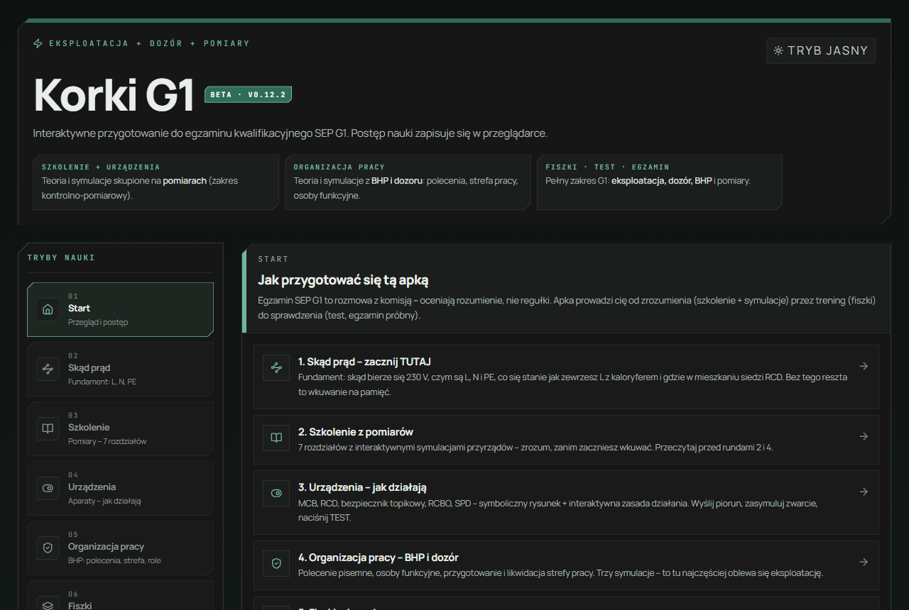

# Korki G1

Interaktywny trener do egzaminu kwalifikacyjnego SEP G1 (eksploatacja i dozór, do 1 kV).
Nazwa to gra słów: „korki” to potocznie bezpieczniki, a też korepetycje.
Teoria i symulacje skupiają się na pomiarach. Fiszki, test i egzamin próbny obejmują cały zakres G1:
eksploatację, dozór, BHP i pierwszą pomoc.

To mój prywatny projekt poboczny. Zrobiłem go do własnej nauki i udostępniam za darmo.
Kod i treść napisał model AI Claude (Anthropic) na moje polecenie – zobacz [Jak powstała treść](#jak-powstała-treść).

**Otwórz aplikację:** <https://pawelkikta.github.io/korki-g1/>



## Co zawiera

- **Szkolenie** – 7 rozdziałów o pomiarach: podstawy prawne, rezystancja izolacji, ciągłość PE, pętla zwarcia,
  RCD, uziemienie, protokół i odbiór instalacji. Każdy rozdział ma interaktywną symulację.
- **Urządzenia** – bezpiecznik topikowy, wyłącznik nadprądowy, RCD, RCBO, ogranicznik przepięć
  i kalkulator doboru zabezpieczenia.
- **Organizacja pracy** – polecenie pisemne, osoby funkcyjne, przygotowanie strefy pracy.
- **Fiszki** – 55 pytań w 4 rundach, jak na egzaminie ustnym, z pytaniami dodatkowymi komisji.
- **Test ABCD** (50 pytań) i **egzamin próbny** (10 losowych pytań).
- **Ściąga** z wartościami granicznymi i **słowniczek** pojęć i skrótów.

Postęp nauki zapisuje się tylko w Twojej przeglądarce (`localStorage`). Aplikacja nie wysyła żadnych danych
i nie ma analityki.

## Instalacja jako aplikacja

Aplikacja to PWA: możesz ją zainstalować z przeglądarki. Po pierwszym otwarciu działa bez internetu.

- **Windows, macOS, Linux** – otwórz stronę w Chrome lub Edge i kliknij ikonę instalacji na końcu paska adresu
  (albo w menu przeglądarki wybierz „Zainstaluj…”).
- **Android** – w Chrome otwórz menu ⋮ i wybierz „Zainstaluj aplikację” lub „Dodaj do ekranu głównego”.
- **iPhone i iPad** – w Safari kliknij „Udostępnij”, potem „Do ekranu początkowego”.

Nowa wersja ładuje się sama przy kolejnym otwarciu. Postęp nauki zostaje.

## Uruchomienie lokalne

Potrzebujesz Node.js 20.19+ lub 22.12+.

```bash
npm ci
npm run dev
```

Wersja produkcyjna trafia do `dist/`:

```bash
npm run build
npm run preview
```

Stack: React 19, Vite, Tailwind CSS 4, framer-motion, vite-plugin-pwa. Fonty są w paczkach npm,
więc aplikacja nie łączy się z Google Fonts.

Publikacja: workflow [`.github/workflows/pages.yml`](.github/workflows/pages.yml) buduje aplikację
i wdraża ją na GitHub Pages po każdym pushu do `main`.

## Jak powstała treść

Pytania, odpowiedzi, rozdziały, ściągę, słowniczek i kod napisał model AI **Claude** (Anthropic)
na moje polecenie, w trakcie mojej nauki do egzaminu SEP G1. Ja wybierałem zakres, zadawałem pytania,
zgłaszałem błędy i decydowałem o poprawkach. Sprawdzanie też robiłem z pomocą Claude:

- **Przepisy** porównałem z aktualnymi tekstami jednolitymi z Dziennika Ustaw (API Sejmu, listopad 2026):
  - Prawo budowlane, art. 62 (Dz.U. 2026 poz. 524),
  - Prawo energetyczne, art. 54 (Dz.U. 2026 poz. 43) i art. 25 ustawy z 20 maja 2021 r. (Dz.U. 2021 poz. 1093),
  - rozporządzenie w sprawie kwalifikacji (Dz.U. 2022 poz. 1392),
  - rozporządzenie BHP przy urządzeniach energetycznych (Dz.U. 2021 poz. 1210),
  - rozporządzenie o ochronie przeciwpożarowej (Dz.U. 2023 poz. 822),
  - rozporządzenie o atmosferze wybuchowej w miejscu pracy (Dz.U. 2010 poz. 931).
- **Wartości z norm** (PN-HD 60364-4-41 i -6, PN-EN 61008/61009, PN-EN 60898-1, PN-EN 61557-4) porównałem
  ze znanymi wartościami granicznymi tych norm. Pełnych tekstów norm tu nie ma i nie były cytowane.
- **Symulacje** sprawdzałem wizualnie: czy rysunek i wynik zgadzają się z działaniem prawdziwego urządzenia.

To nie jest recenzja eksperta. Traktuj aplikację jako pomoc do nauki, nie jako źródło.

## Zastrzeżenia

- Projekt **nie jest powiązany** ze Stowarzyszeniem Elektryków Polskich (SEP) ani z żadną komisją kwalifikacyjną.
- Treść napisał model AI i może zawierać błędy, także takie, których nie wyłapałem. Aplikacja podaje
  numery norm i wartości z norm, ale nie zawiera tekstu norm PN-EN i PN-HD.
- **Nie daję gwarancji**, że odpowiedzi są pełne i aktualne. Przepisy i normy się zmieniają. Przed egzaminem
  i przed pracą przy instalacjach sprawdzaj aktualne przepisy, normy i swoje uprawnienia.
  Aplikacja nie zastępuje szkolenia.
- Znalazłeś błąd merytoryczny? Zgłoś go w [Issues](https://github.com/pawelkikta/korki-g1/issues),
  najlepiej z podstawą prawną lub numerem normy.

## Licencja

- Kod: [MIT](LICENSE).
- Treść edukacyjna (pytania, odpowiedzi, rozdziały, ściąga, słowniczek): [CC0 1.0](LICENSE-CONTENT.md) –
  domena publiczna, możesz jej używać bez warunków.
- Fonty Manrope i JetBrains Mono: SIL Open Font License 1.1 (paczki `@fontsource-variable`).
  Ikony interfejsu: [Lucide](https://lucide.dev) (ISC).

## Autor

Paweł Kikta – [github.com/pawelkikta](https://github.com/pawelkikta)
